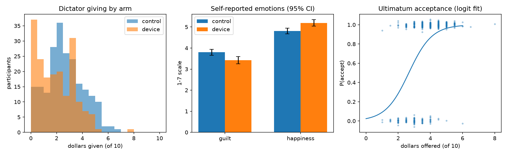
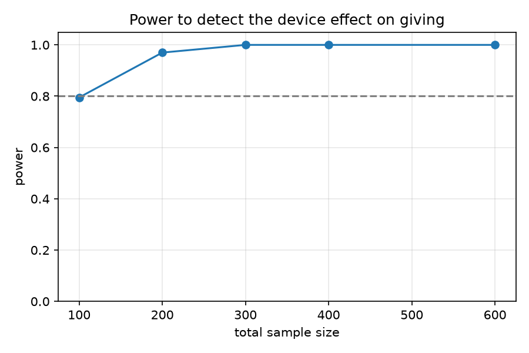

# Decision Devices, Guilt & Happiness: Dictator / Ultimatum Game Analysis

A reproducible analysis pipeline for a two-arm online economics experiment. It tests whether letting people hand an allocation decision to an external **decision device** (a randomizer) changes how much they give, and how guilty and happy they feel afterward.

> **Data note:** the dataset is **simulated** (`src/simulate.py`) from known "true" parameters. No real participants' data is used. Because the true effects are known, the pipeline can be checked: does the analysis recover what was built into the data? The design follows the kind of behavioral-economics study I supported as a research assistant. I rebuilt it here in Python with synthetic data so it can be shared publicly.



## Design

- **Arms:** `control` (participants choose their own split of $10) vs. `device` (participants can delegate the choice to a randomizer).
- **Tasks:** one Dictator round and one Ultimatum round as proposer, then guilt and happiness ratings on a 1–7 scale.
- **n = 400** (simulated), randomized 50/50, with sex and econ-major covariates.

## Analysis

| Step | Method |
| --- | --- |
| Randomization check | Balance t-tests on covariates (`reports/balance.csv`) |
| Treatment effect on giving | OLS with HC1 robust SEs and covariates |
| Guilt and happiness | OLS separating the direct device effect from the effect of how much was given or kept |
| Ultimatum acceptance | Logit of acceptance on offer size |
| Design | Simulation-based power curve: 200 simulated experiments per sample size |

## Results: estimates vs. ground truth (n = 400)

| Outcome | Term | Estimate | 95% CI | True value |
| --- | --- | --- | --- | --- |
| Dictator giving ($) | device | −0.75 | [−1.02, −0.48] | −0.90 ✓ |
| Guilt | device | −0.52 | [−0.73, −0.31] | −0.60 ✓ |
| Guilt | $ given | −0.25 | [−0.31, −0.18] | −0.35 ✗ |
| Happiness | device | +0.32 | [0.12, 0.52] | +0.30 ✓ |
| Happiness | $ kept | +0.14 | [0.07, 0.20] | +0.12 ✓ |

**Findings**
- Access to a decision device lowers giving by about $0.75 out of $10, and lowers guilt even after holding the amount given constant. Delegating seems to work as moral cover.
- **Measurement matters.** The guilt-on-giving slope is pulled toward zero, and its CI misses the truth. The cause is the 1–7 Likert scale: rounding and clipping a continuous feeling attenuates continuous slopes. Binary treatment effects are much less affected. The test suite checks this at n = 5,000. Every treatment effect is recovered, and every slope keeps the right sign but comes out smaller than the truth. That's a practical reason to prefer finer-grained or multi-item emotion measures.
- **Power:** about 80% power at n = 100 and 97% at n = 200 for the giving effect, so a 400-person study is comfortably powered for the main outcome.



## Run it

```bash
pip install -r requirements.txt
python src/simulate.py          # writes data/experiment.csv
cd src && python analyze.py     # tables in reports/, figures in figures/
cd .. && pytest -q
```

## Stack

Python · statsmodels (OLS with robust SEs, logit) · SciPy · pandas · Matplotlib · pytest
